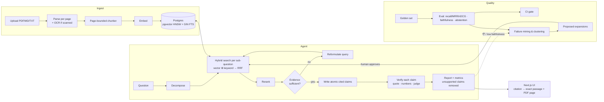

# Enterprise AI Research Agent with Verifiable Citations

Ask complex questions across hundreds of PDFs and docs. The agent plans, retrieves with **hybrid search**, compares sources, writes a report, and then **checks every claim against the exact passage it cites** — dropping anything it can't support. Reliability is measured, not assumed: a built-in evaluation harness and a failed-query feedback loop ship with it.

> **Why it's different:** most RAG demos stop at "answer + links". Here every claim carries a verdict, a *verbatim* supporting quote, and a page-level citation; unsupported claims are removed and reported; the agent abstains when the library can't answer; and quality is gated in CI.

## Highlights
| Area | What's implemented |
|---|---|
| **Retrieval** | pgvector (HNSW cosine) + Postgres full-text (GIN, `ts_rank_cd`) fused with **Reciprocal Rank Fusion**; pluggable embeddings (offline hash · local sentence-transformers · OpenAI-compatible) |
| **Agent** | query decomposition → multi-step retrieval with gap detection & query reformulation → reranking (lexical · LLM · cross-encoder) → cited report. Runs **offline** (heuristic engine) or with Anthropic / OpenAI-compatible LLMs |
| **Verifiable citations** | atomic claims → each cites evidence IDs → verifier (LLM judge ⊕ lexical check): verbatim quote must exist in the passage, numbers must match, a "supported" judge verdict is downgraded if it can't be corroborated. Citations resolve to `…/file#page=N` |
| **Ingestion** | PDF / MD / TXT, page-bounded sentence-packing chunker (so every chunk maps to one page), content-hash dedupe, async processing, **OCR for scanned PDFs** |
| **Evaluation** | recall@k · MRR · nDCG per search mode; answer correctness, faithfulness, unsupported-claim rate, gold-citation rate, abstention accuracy; golden sets as `(file, page, passage)` so they survive re-chunking; **CI quality gate** |
| **Feedback loop** | 👍/👎 + empty/low-faithfulness runs mined and clustered; root-cause diagnosis with concrete fixes; learned query expansions with **human approval** and a **leak-free train/test split** |
| **Web UI** | live agent timeline (SSE), report with per-claim verdicts, citation → source panel with highlighted quote + PDF at the right page, library, eval dashboard, feedback review, dark mode |
| **Ops** | Alembic migrations (adopts pre-migration DBs), optional API-key auth, rate limiting, signed document links, request IDs + access log, Docker Compose, GitHub Actions CI |

## Architecture


## Quick start
```bash
cp .env.example .env
make up                                   # Postgres+pgvector · API :8000 · Web :3000
make ingest-samples                       # 6 sample docs
python scripts/ask.py "How does RRF work, and how do we measure hallucination in RAG?"
open http://localhost:3000                # the UI   (API docs: http://localhost:8000/docs)
```
No API key needed — the default engine is fully offline. For fluent comparative reports set `LLM_PROVIDER=anthropic|openai` (+ key) and, for real semantic recall, `EMBEDDING_PROVIDER=local|openai` (changing `EMBEDDING_DIM` needs a fresh DB: `docker compose down -v`).
Scanned PDFs: `ENABLE_OCR=true make up` then `OCR_ENABLED=true`.

**Without Docker:** run Postgres with the `vector` extension, `pip install -r backend/requirements.txt`, `cd backend && uvicorn app.main:app`, then `make web-dev`.

## Measured behaviour (honest numbers)
Demo corpus: 6 docs → 42 chunks, offline hash embedder, 11-case hand-written paraphrase golden set (`samples/golden_sample.jsonl`), fresh DB, no learned expansions:

| mode | recall@1 | recall@5 | MRR | nDCG@10 |
|---|---|---|---|---|
| hybrid | 0.44 | 0.78 | 0.58 | 0.66 |
| keyword | 0.44 | 0.78 | 0.62 | 0.71 |
| vector (hash) | 0.22 | 0.44 | 0.34 | 0.42 |

Answers (offline extractive engine): faithfulness **100%**, unsupported-claim rate **0%**, abstention on unanswerable questions **100%**, answer correctness 39%.
**How to read this:** the offline hash embedder is deliberately weak, so dense retrieval drags hybrid below keyword — exactly the kind of finding the harness exists to surface (the diagnosis points at `semantic_gap` → use a real embedding model). Correctness is low because the offline writer is extractive; faithfulness stays perfect because it only quotes. These are demo-scale numbers on 11 cases, not benchmarks.

## Configuration (selected)
| Variable | Default | Purpose |
|---|---|---|
| `EMBEDDING_PROVIDER` / `_MODEL` / `_DIM` | `hash` / – / `384` | `hash`, `local`, `openai` |
| `LLM_PROVIDER` / `LLM_MODEL` | `none` | `none` (offline), `anthropic`, `openai` |
| `RERANKER` | `lexical` | `lexical`, `llm`, `cross-encoder` |
| `STRICT_CITATIONS` | `true` | drop claims the verifier rejects |
| `CHUNK_TARGET_WORDS` / `CHUNK_OVERLAP_WORDS` | `180` / `40` | chunking |
| `MAX_ROUNDS`, `CANDIDATE_K`, `SUFFICIENCY_THRESHOLD` | `2`, `20`, `0.35` | multi-step retrieval |
| `API_KEYS`, `RATE_LIMIT_PER_MIN`, `RATE_LIMIT_HEAVY_PER_MIN` | off | auth & throttling |
| `OCR_ENABLED`, `OCR_LANG` | `false`, `eng` | scanned PDFs |

## API
`POST /api/documents` · `GET /api/documents/{id}/signed-url` · `POST /api/search` · `GET /api/chunks/{id}` · `POST /api/research` (+ `/stream` SSE) · `POST /api/research/{id}/feedback` · `POST /api/eval/sets[/generate]` · `POST /api/eval/runs` · `GET /api/eval/compare` · `GET /api/feedback/failures` · `…/feedback/expansions` — full OpenAPI at `/docs`.

## Security & operations
- **Auth (optional):** `API_KEYS=k1,k2` → `X-API-Key` / `Bearer`. `/health` and `/docs` stay open. PDFs open via **5-minute HMAC-signed links** because `<iframe>` can't send headers; a signed token unlocks exactly one file, nothing else.
- **Rate limiting:** sliding window per key/IP, with a stricter bucket for agent/eval endpoints; returns `429` + `Retry-After`. In-memory (per process) — use Redis or a gateway for multi-replica deployments.
- **Observability:** `X-Request-ID` and `Server-Timing` on every response; one structured access-log line per request. Every agent run persists its full trace.
- **Caveat:** `NEXT_PUBLIC_API_KEY` is visible to browser users. Fine for an internal tool; for public deployments put real user auth (SSO / reverse proxy) in front.
- **Schema:** Alembic (`backend/app/migrations`), applied at startup under an advisory lock. Databases created by earlier releases are adopted automatically. Create a migration: `cd backend && alembic revision --autogenerate -m "…"`.

## Project layout
```
backend/app/
  agent/        decompose · rerank · writer · verifier · core (the research loop) · llm clients
  eval/         metrics · gold matching · golden-set generation · runner · diagnosis
  services/     parsing (+OCR) · chunking · embeddings · fusion · search · ingest · research · evaluation · feedback
  api/          documents · search · research · evaluation · feedback · health
  middleware.py auth · rate limit · signed links · access log        migrations/  Alembic
backend/tests/ (unit, DB-free)   backend/tests_integration/ (live Postgres)
web/src/       app/ (research · library · eval · feedback)  components/  lib/ (typed API client, SSE parser)
eval/thresholds.json  CI quality gate     samples/  demo corpus + golden set     docs/  design notes
```

## Testing
`make test` — 35 backend unit tests (chunking, RRF, metrics, diagnosis, agent incl. hallucination-catching, auth/rate-limit/streaming middleware, OCR on a real image-only PDF)
`make test-integration TEST_DATABASE_URL=…` — 9 tests on real Postgres+pgvector (ingestion → search → agent → eval → feedback; migrations incl. legacy adoption & downgrade)
`make test-web` — typecheck, SSE/quote-locator tests, production build   ·   `make eval` — the quality gate
CI (`.github/workflows/ci.yml`): unit · integration · web · eval gate · docker build.

## Limitations & next steps
- Heuristic engine is for offline demos; use an LLM for production-quality prose. LLM clients are implemented but were not exercised against live provider APIs in development.
- Learned expansions only help when vocabulary gaps recur; they need a larger golden set to show measurable gains (the harness reports the held-out delta honestly).
- Native PDF viewers can't highlight text; the highlight is shown in the passage panel beside the page.
- Not yet: per-user accounts/ACLs, multi-tenant isolation, streaming ingestion progress, table/figure extraction, a managed job queue (ingestion uses FastAPI background tasks).

See [`docs/DESIGN.md`](docs/DESIGN.md) for design decisions and trade-offs, and [`docs/TALKING_POINTS.md`](docs/TALKING_POINTS.md) for how to present this project.
